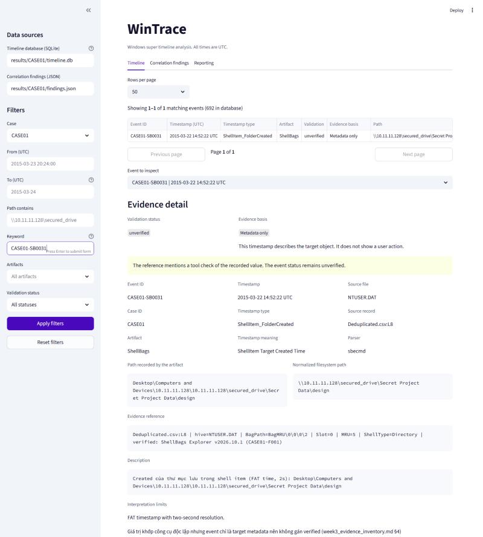

# Tuần 3 – Ngày 17: Kiểm tra evidence detail viewer

Dữ liệu: `results/CASE01/timeline.db` (692 event). Chạy: `python -m streamlit run src\app.py`.

## Đã kiểm trên trình duyệt (2026-11-26, Streamlit 1.57)

Lọc keyword `CASE01-SB0031`:

- [x] Nhãn `unverified` và `Metadata only`, có câu nói rõ không phải hành vi người dùng
- [x] Cảnh báo chữ `verified:` trong reference không đổi trạng thái event
- [x] Có event ID, case, artifact, timestamp, type, meaning, source file, source record, parser
- [x] Path BagMRU cạnh path UNC; path xuống dòng, không bị cắt
- [x] Evidence reference nguyên văn; giới hạn FAT 2 giây và `verification_note`
- [x] Không tràn ngang ở 375 px

## Đã kiểm bằng test tự động (`tests/test_ui_evidence.py`)

- [x] `CASE01-SB0133`: hiện đủ provenance, trạng thái `verified`
- [x] 692/692 event nhận nhãn theo contract; nhãn lạ thành `Not classified`
- [x] Thiếu reference, source record, timestamp type, case ID thì có cảnh báo
- [x] Ký tự Markdown và path dài 600+ ký tự hiển thị nguyên văn

## Chờ review

- [ ] Phúc: provenance và giới hạn diễn giải
- [ ] Thi: câu chữ nhãn bằng chứng
